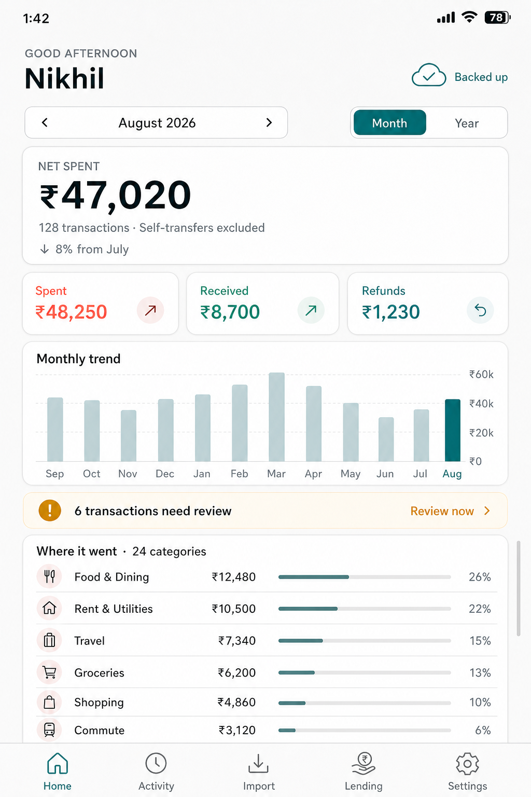
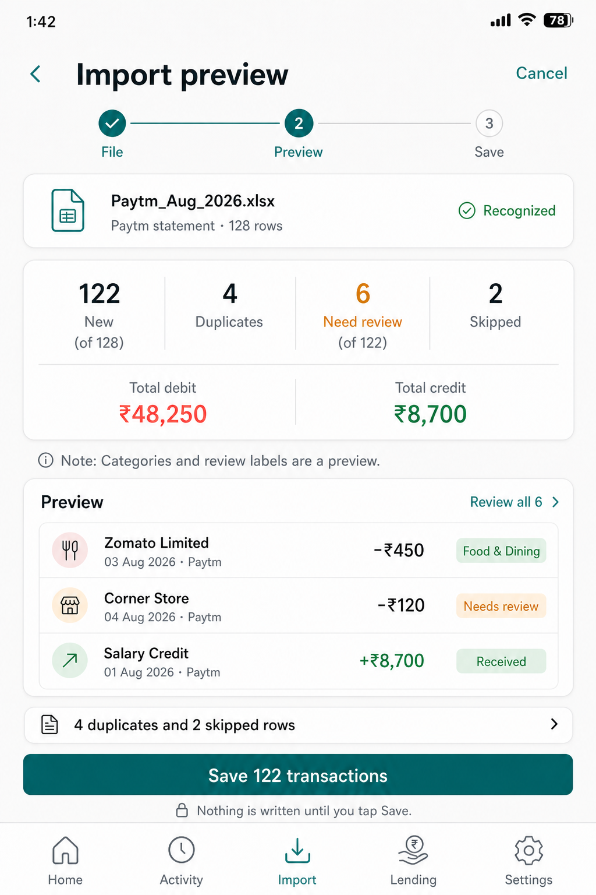
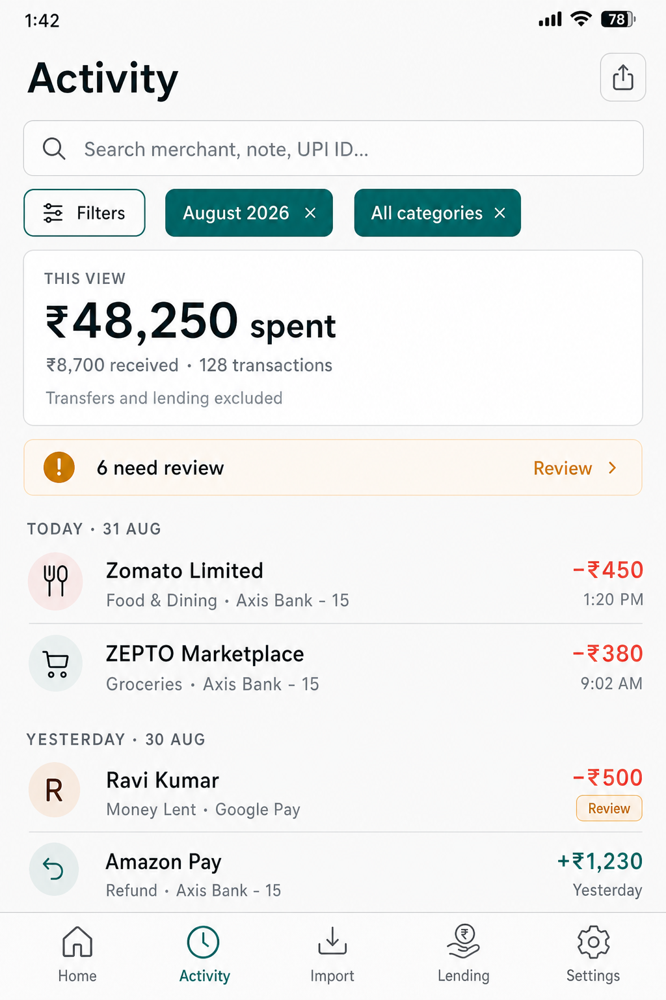
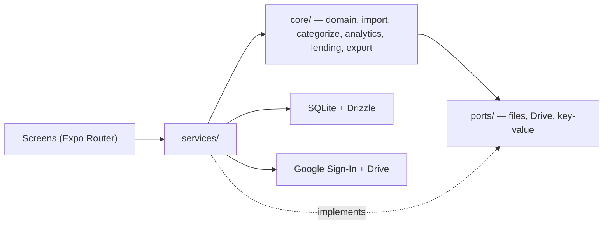

<div align="center">


# Finance Tracker

**Import Indian bank and UPI statements, auto-categorize spending, and keep a local ledger you can back up to Google Drive.**

[](https://docs.expo.dev/versions/v57.0.0/)

[](https://www.typescriptlang.org)
[](https://reactnative.dev)

[Features](#features) · [Getting started](#getting-started) · [Running the app](#running-the-app) · [Architecture](#architecture) · [Troubleshooting](#troubleshooting)

</div>

A local-first Android and iPhone app (Expo / React Native) that replaces a yearly Excel tracker. Pick a statement, preview every parsed row, save only what you confirm, then review dashboards, activity, and informal loans — with self-transfers, refunds, and card-bill payments counted the way a ledger should.

<p align="center">
  
  
  
</p>

> [!NOTE]
> Amounts are **Indian Rupees (₹)**. The phone keeps an on-device SQLite database and syncs it with one live file (`finance-live.db`) in your Google Drive. A companion website ([`web/`](web/)) opens the same file. Only one device edits at a time: a second device asks **Take over** or **View only**.

## Features

- **Statement import** — Paytm UPI (`.xlsx`), Axis Bank, Karur Vysya Bank, and SBI (`.xls` / `.xlsx`), plus password-protected Axis credit-card PDFs. Detection is automatic; overlapping files are de-duplicated before save.
- **Preview then save** — totals, duplicates, skipped rows, and suggested categories are shown first. Nothing is written until you confirm. The last import can be reverted as a batch.
- **Auto-categorization** — merchant rules, Paytm tags, and learned edits pick a category and sub-category. Low-confidence rows are flagged **Needs review**.
- **Honest totals** — self-transfers are excluded from spend and income; refunds offset spending; a linked credit-card bill is counted once.
- **Home and Activity** — month/year net spent, category breakdown, search and filters, and a filtered Excel export.
- **Lending** — informal loans with people, principal / repayment / interest, split allocations across loans, and close / reopen.
- **Settings** — categories, payment modes, people, light / dark / system appearance, biometric app lock, local backup, Google Drive sync / restore, and the edit lock status (Take over / View only).

## Supported statements

| Source | File types | Notes |
| --- | --- | --- |
| Paytm UPI | `.xlsx` | Passbook Payment History sheet |
| Axis Bank | `.xls` · `.xlsx` | |
| Karur Vysya Bank | `.xlsx` | |
| State Bank of India | `.xlsx` | |
| Axis Credit Card | `.pdf` | Always encrypted — the app asks for the password |

PhonePe, Google Pay, and other card issuers are not parsers yet; the import pipeline is built so a new adapter can be added without rewriting the rest of the app.

## Getting started

### Prerequisites

- [Node.js 20+](https://nodejs.org/) (LTS)
- [Git](https://git-scm.com/downloads)
- **Android:** [Android Studio](https://developer.android.com/studio) with an emulator or a USB device
- **iOS:** a Mac with Xcode, **or** the unsigned IPA workflow below (no paid Apple Developer account)

Clone the repo and install dependencies:

```bash
git clone https://github.com/KothaNikhil/Finance-Tracker.git
cd Finance-Tracker/mobile
npm install
```

> [!TIP]
> `npm run web` is the fastest way to click through screens. Google Drive backup and native file pickers are limited or omitted on web — use Android or iOS for a full import / backup loop.

### Optional: real Google sign-in

In `__DEV__` the login gate is skipped so emulators stay usable. For a release build, or to test sign-in on a device:

1. Create a [Supabase](https://supabase.com/) project and enable Google as an auth provider.
2. Put the project URL and publishable key in `mobile/src/services/auth/config.ts`.
3. Register Android / iOS / Web OAuth clients in Google Cloud, matching `com.financetracker.app` and the signing certificate SHA-1. The web client ID belongs in `mobile/src/services/drive/config.ts`.

Until those values are real credentials, the app still runs — it just does not show the login screen.

## Running the app

All commands run from `mobile/`:

```bash
npm test           # unit tests (core logic + UI)
npm run typecheck  # TypeScript
npm run lint       # ESLint (expo)
npm run web        # browser preview
npm run android    # Android emulator or device
npm run ios        # iOS simulator (macOS)
npm start          # Expo dev server (scan QR / press a / i / w)
```

For debug and release build commands (Android APK/AAB, iOS, and the web app), see [docs/BUILD.md](docs/BUILD.md).

### iOS without a Mac

The [iOS unsigned build](https://github.com/KothaNikhil/Finance-Tracker/actions/workflows/ios-build.yml) workflow is **manual** (`workflow_dispatch`). It produces an unsigned `.ipa` you can sign locally with a free Apple ID (Sideloadly or AltStore). Free-ID installs expire after 7 days; re-sign the same IPA — no rebuild required.

> [!IMPORTANT]
> Do not commit real bank or UPI statements. The local folder `Refernce sample data/` is gitignored on purpose. Importer integration tests read it when present and skip when it is not.

## Architecture

Business logic lives in **plain TypeScript** with no React Native imports, so it can be unit-tested in Node and shared by the phone app and the website.



| Path | Role |
| --- | --- |
| [`mobile/`](mobile/) | Expo app (SDK 57, React Native 0.86) |
| [`packages/core/`](packages/core/) | Pure-TS “brain” shared by both apps: money in paise, adapters, categorizer, aggregates, Excel model, schema + migrations, Drive sync engine and edit lock |
| [`mobile/src/services/`](mobile/src/services/) | Phone implementations of ports: SQLite, Drive, auth, file I/O |
| [`web/`](web/) | Website (Vite + React + sql.js); see [`web/README.md`](web/README.md) and [`docs/WEB_PLAN.md`](docs/WEB_PLAN.md) |
| [`mobile/src/app/`](mobile/src/app/) | Tabs: Home, Activity, Import, Lending, Settings |
| [`docs/Requirements.md`](docs/Requirements.md) | Product requirements |
| [`docs/design/mockups/`](docs/design/mockups/) | Approved UI mockups |

Adding a statement source means a new adapter in `packages/core/src/import/adapters/` registered in `formats.ts` — the pipeline, preview UI, and dedupe stay the same.

## Troubleshooting

### Google sign-in never appears on the emulator

Expected in development: `DEV_BYPASS_LOGIN` is tied to `__DEV__`. Test the real flow on a device with Play Services (Android) or a signed iOS build, with OAuth clients registered for that app’s package and signing key.

### Encrypted PDF / workbook will not open

Axis credit-card statements are always password-protected. Enter the password from the bank (often a date of birth or card digits — whatever the issuer printed). A wrong password can be retried without leaving the import flow.

### Totals look “wrong” after a card bill or transfer

Self-transfers never count as spend or income. A bank payment linked to a credit-card statement is excluded so the statement’s purchases are not double-counted; an **unlinked** bill payment still counts. Refunds apply only to eligible incoming rows.

### Import saved nothing / empty batch

Statements with zero usable rows are not stored. Overlapping files should show duplicates on the preview — those rows are reconciled, not inserted again. Use **Revert last import** on the Import tab if a save should be undone.

### “View only” — changes aren’t saved

Another device (phone or browser tab) is editing. Tap **Take over** in the banner to edit here; the other device switches to view only. A device that stops responding releases the lock after about 3 minutes.

### Phone says offline changes were discarded

The phone was edited offline while another device took over. Drive’s copy wins; the phone’s offline changes are kept in a `-discarded-offline.db` snapshot so nothing is silently lost.

### Tests fail on a clean clone

Run `npm install` then `npm test` from `mobile/`. Integration tests that need real sample files skip when `Refernce sample data/` is absent; unit tests should still pass.

> [!IMPORTANT]
> If something still looks off, open **Settings** and take a local backup before deleting data or restoring from Drive. Restore overwrites the on-device database.
