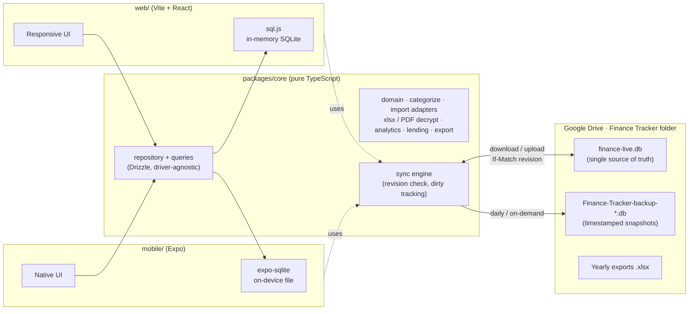

# Finance Tracker — Website plan

Status: **in progress** — Phases 0–4 built on `feat/web-platform`, including the single-editor lock (§2.1a). Written 2026-11-23, updated 2026-11-25.

A browser version of the Finance Tracker app with the same features as the phone app, built for
large imports and big screens, and still usable at tablet and phone widths.

---

## 1. Decisions

| Topic | Decision |
|---|---|
| Where data lives | **Google Drive is the single source of truth.** One SQLite file in the user's "Finance Tracker" Drive folder. |
| Website storage | **Nothing stored in the browser.** The file is downloaded into memory on sign-in and written back to Drive. Closing the tab leaves no financial data behind. |
| Phone storage | The phone **keeps its local copy** (offline use, speed) but treats Drive as the boss: pull on open if Drive is newer, push after edits. |
| Concurrency | **One device edits at a time**, enforced by an edit lock on Drive (`finance-session.json`) with **Take over** / **View only**. A Drive revision check before every upload stays as a backstop. No live multi-device sync. |
| Saving | **Autosave** a few seconds after each change, with a visible save status. |
| Login on the website | **Google only.** Drive needs a Google account; email-OTP accounts can't use the website. |
| Offline website | Not supported. The website needs internet. |
| Frontend | A **separate React website** (not the Expo web build), sharing the pure-TS logic with the phone app. |
| Repo layout | Monorepo: `packages/core` shared, `mobile/` stays where it is, new `web/`. |
| Hosting | Run locally until approved, then deploy to Cloudflare Pages or Netlify (free). |
| Cost | Everything stays free. No paid services or tools. |

Out of scope for now: a cloud database (Supabase-as-DB), real-time sync, offline web, email-OTP on web,
multi-user and family sharing.

---

## 2. Architecture



### 2.1 The Drive file and the revision check

Today the phone writes a **new timestamped file on each backup** and `syncDownFromDrive` picks the
newest one. With two devices editing, that model can't detect conflicts. The plan:

- **One live file**, `finance-live.db`, updated in place (Drive `files.update` media upload). Every
  device reads and writes this file.
- Each device remembers the Drive **`headRevisionId`** (plus `modifiedTime`) of the version it loaded.
- **Before uploading**, fetch the file's current metadata. If the revision changed since load, the
  upload stops. With the edit lock (§2.1a) this should only happen if the lock was bypassed, so it
  is a backstop, not the normal way to resolve two editors.
- **Timestamped snapshots** keep working as history/safety (e.g. first save of each day, before an
  overwrite, before a revert-import, and on manual "Back up now"). Prune old snapshots (keep e.g. last 30).
- Migration: on first run of the new versions, if `finance-live.db` doesn't exist, seed it from
  the newest existing snapshot.

### 2.1a The edit lock (one device edits at a time)

Whole-file sync can't merge two sets of edits, so only one device may edit at a time.

- A small lock file, **`finance-session.json`**, sits next to `finance-live.db`. It names the
  device holding it (phone or browser), when it took it, and a heartbeat time.
- The holder refreshes the heartbeat every **60 s**. A lock with no heartbeat for **3 min** is stale
  and can be taken without asking. Drive API v3 has no ETags, so a lock write first checks that
  the file's `version` hasn't changed since it was read, then reads the content back; the loser of a
  race finds out at once or, at the latest, on its next heartbeat.
- Opening the app while another device holds a fresh lock asks: **Take over** (this device edits;
  the other one becomes view only on its next heartbeat or sync) or **View only**.
- **View only** means nothing is editable on any page: edit controls are disabled and show
  *"View only. Take over to edit."* Import preview still works but Save is disabled; the transaction
  detail opens with its fields disabled. The database layer also refuses writes (`ReadOnlyError`).
  A banner offers **Take over** at any time.
- Every Drive upload checks the lock first (`beforeWrite`). A device that has lost the lock never uploads.
- **Website:** editing needs the lock *and* a connection. Offline or after a failed token renew the
  site is read-only (*"You're offline · editing paused"*). The lock is released when the tab closes
  (`pagehide`, keepalive request). If another device takes over, unsaved edits are saved to a
  snapshot and the page reloads Drive's copy.
- **Phone:** offline editing stays allowed, with a banner warning that the changes are lost if
  another device edits before the phone reconnects. On reconnect, if the lock was taken meanwhile,
  the phone keeps a `-discarded-offline.db` snapshot of its changes, pulls Drive's copy, and says so.

### 2.2 Website session lifecycle

1. Sign in with Google (Supabase OAuth for identity, plus Google Identity Services token client for
   the `drive.file` scope).
2. Find the Drive folder and `finance-live.db`. Download it into memory, run schema migrations, open with sql.js.
   - No file found: offer **Start fresh** (seeded lists) or explain that the phone app's backup will
     appear once the phone app is updated.
3. Claim the edit lock (§2.1a). If another device holds it, ask **Take over** or **View only**.
   Keep the heartbeat running while editing.
4. Work. Every write marks the session **dirty** and schedules an autosave (debounce ~3 s, max wait ~30 s).
5. Autosave: confirm the lock is still held, export the DB bytes, run the revision check, upload,
   store the new revision.
6. Close tab with unsaved changes: browser "Leave site?" warning. Closing the tab releases the lock.
   Sign out: flush, release the lock, then wipe memory.
7. Access token expiry (~1 h): renew silently. If that fails, show a "Reconnect Google Drive" banner;
   changes stay in memory and the save status shows **Not saved**.

Save status (top bar, always visible): **Saved · 2 min ago** / **Saving…** / **Unsaved changes** /
**Offline — will retry** / **Conflict — action needed** / **Reconnect Drive** / **In use on phone** /
**View only**.

### 2.3 Phone changes

- Use the same sync engine: on app open/foreground, resolve the edit lock first (§2.1a), then check
  Drive's revision. If Drive is newer and the phone has no unsaved changes, pull.
- After edits, push in the background (debounced), on app background, and on "Back up now" — only
  while the phone holds the lock.
- If offline, keep working locally and warn that the changes are lost if another device edits first.
  Push when back online; if the lock was taken meanwhile, snapshot and discard the offline changes.

### 2.4 Schema compatibility

Both apps open the same file, so:

- The Drizzle schema and **migrations live in `packages/core`**, versioned (`PRAGMA user_version`).
- An app that opens a file **newer than it understands** goes read-only and asks you to update,
  instead of corrupting it.
- Both apps run pending migrations on load before any read.

### 2.5 Google setup

- `drive.file` only lets an app see files it created, where "app" means the **Google Cloud project**.
  The existing `WEB_CLIENT_ID` (`mobile/src/services/drive/config.ts`) is in the same project as the
  Android client, so the website can reuse it and will see the phone's files. Confirm in the
  console during Phase 2.
- Add the website origins (`http://localhost:5173`, later the hosted URL) as **Authorized JavaScript
  origins** on that client and as **Redirect URLs** in Supabase.

---

## 3. Website tech stack

| Area | Choice | Why |
|---|---|---|
| Build | Vite + React 19 + TypeScript | Static output, fast dev server, no server code |
| Routing | React Router | Plain URL routes, deep links to a transaction (`/transactions?txn=1284`) |
| Database | sql.js (SQLite WASM, in memory) + `drizzle-orm/sql-js` | No browser storage. No COOP/COEP headers needed, so hosting stays simple. |
| Reactivity | Small `useQuery` hook that re-runs on a DB change event | Same mental model as the phone's `useLiveQuery` |
| Tables | TanStack Table + TanStack Virtual | Thousands of rows, sort, column filters, row selection, bulk edit |
| Styling | Tailwind CSS with the same tokens as `mobile/src/constants/theme.ts` | Same look; responsive breakpoints built in |
| Charts | Recharts (or ECharts if needed) | Responsive, accessible tooltips |
| Icons | Material Symbols | Same icon names as the app |
| Auth | Supabase JS (Google OAuth) + Google Identity Services (Drive token) | Reuses the existing Supabase project |
| Import | `packages/core` adapters, SheetJS, pure-JS xlsx/PDF decrypt | Already pure JS. Runs unchanged in the browser. |
| Export | ExcelJS → browser download, plus optional "Save to Drive" | Same workbook as the phone |
| Tests | Vitest (core + web), Playwright for end-to-end | Free |

### Layout breakpoints

| Width | Navigation | Transaction detail | Tables |
|---|---|---|---|
| **Desktop** ≥ 1200 px | Full sidebar with labels | Docked side panel (right, ~400 px) | Full column set |
| **Tablet** 720–1199 px | Icon rail | Slide-over drawer from the right | Fewer columns |
| **Phone** < 720 px | Bottom tab bar (same 5 tabs as the app) | Full-screen sheet | Card rows (like the app's Activity list) |

Desktop-only extras: keyboard shortcuts (`/` search, `j`/`k` move, `Enter` open, `e` edit category,
`x` select), multi-row selection with bulk re-categorize / mark reviewed / delete, drag-and-drop of
many statement files at once, column chooser.

---

## 4. Repository layout

```
Finance-Tracker/
├─ package.json            ← npm workspaces: ["packages/*", "mobile", "web"]
├─ packages/
│  └─ core/                ← moved from mobile/src/core + repository/queries + sync engine
├─ mobile/                 ← unchanged location (android/, Metro, app.json untouched)
├─ web/                    ← new Vite app
├─ ui-mocks/
│  └─ web/                 ← website design mocks (Phase 0)
└─ docs/
```

The main refactor: `mobile/src/services/db/repository.ts` (~1,260 lines) and `services/db/queries/`
(~480 lines) are typed against `ExpoSQLiteDatabase`. They move into `packages/core` and take a
generic Drizzle SQLite database (`BaseSQLiteDatabase<'sync' | 'async', …>`), so the phone passes
expo-sqlite and the web passes sql.js. Metro needs `watchFolders` + `nodeModulesPaths` for the workspace package.

---

## 5. Phases

### Phase 0 — Design (done)
Website mocks in `ui-mocks/web/`, reviewed at desktop, tablet and phone widths, in light and dark.
Screens: sign-in and Drive loading, app shell with save status, dashboard, transactions table with
detail panel and bulk actions, multi-file import, lending, settings, and the sync/conflict dialogs.
**Exit:** you approve the mocks.

### Phase 1 — Extract core
- Set up npm workspaces. Move `mobile/src/core` → `packages/core`.
- Make repository + queries driver-agnostic and move them into core.
- Move the schema and migrations into core with `user_version` checks.
- **Exit:** all existing mobile Jest tests pass and the dev build runs unchanged on the emulator.

### Phase 2 — Sync engine + website foundation
- `packages/core/sync`: live-file model, revision check, dirty tracking, snapshot policy (unit-tested
  with a fake Drive).
- `web/`: Vite app, tokens/theme, app shell, Google sign-in, Drive token, load DB into sql.js,
  autosave, save status, conflict dialog, leave-page guard, sign-out wipe.
- **Exit:** sign in on localhost, see real data from Drive, edit a note, see it saved to Drive.

### Phase 3 — Phone moves to the live file
- The phone uses the core sync engine: pull-if-newer on open, debounced push, conflict prompt.
- One-time migration from timestamped backups to `finance-live.db`.
- Edit lock in both apps: Take over / View only, heartbeat, view-only screens, offline discard.
- **Exit:** edit on the phone → reload the website and see it; edit on the website → reopen the phone
  and see it; opening the second device asks Take over / View only, and the device that loses the
  lock becomes view only.

### Phase 4 — Feature parity on the website
In order of value:
1. Transactions table: filters, search, needs-review, the detail panel (both tabs, category picker,
   note, refund/self-transfer, delete), bulk actions.
2. Import: multi-file drag and drop, xlsx + credit-card PDF, password unlock, combined preview,
   save, review, import batches + revert last.
3. Dashboard: period selector, totals, trend, category breakdown + drill-down.
4. Settings: categories/subcategories (add, rename, reorder, delete), payment modes, people,
   appearance, Drive and sync status, snapshots, account, delete all data.
5. Lending: people/loans, loan detail, new/edit loan, manual entry, attach existing, split across loans.
6. Card bill linking. Excel export (download + save to Drive). Debug logs.
- **Exit:** every flow in `ui-mocks/` works on the website.

### Phase 5 — Polish and hosting
- Accessibility pass (keyboard, focus, contrast), performance pass (10k+ rows), Playwright smoke tests.
- Deploy to Cloudflare Pages or Netlify. Add the production origin to Google + Supabase.
- **Exit:** the hosted site works end to end with your real account.

---

## 6. Risks and mitigations

| Risk | Mitigation |
|---|---|
| Tab closed before autosave finishes | Short debounce, "Leave site?" guard, visible **Unsaved** status |
| Both devices edited | Edit lock: only one device edits; the other is view only. Revision check before upload as a backstop; snapshot before discarding offline phone edits or reloading a tab that lost the lock |
| Device crashes holding the lock | 3 min heartbeat timeout; the next device takes it without asking |
| Older app opens a newer schema | `user_version` gate → read-only + "update the app" message |
| Drive token expires mid-session | Silent renew; on failure keep changes in memory and show **Reconnect Drive** |
| DB grows large | It's a few MB today; full download/upload stays fast for years. Revisit only past ~50 MB. |
| sql.js memory on low-end phones (web) | Acceptable at current size; the phone app remains the main mobile client |
| Data visible on a shared computer | Nothing persisted; sign-out wipes memory; optional idle auto sign-out |
| `drive.file` can't see phone files | Confirm both clients share one Cloud project (they appear to) |
